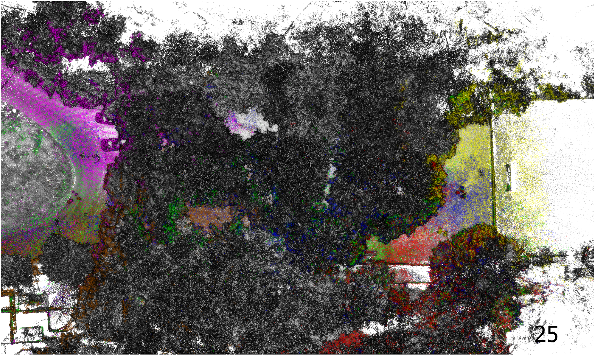

# GCPC Rigid Georeferencing

Georeference a survey-grade point cloud to a global coordinate system using a set of
small GNSS-enabled **Ground Control Point Clouds (GCPCs)**.



## Concept

Each GCPC is a small area captured with a GNSS-enabled scanner (global coordinates).
The point cloud covers the full site but is in a local frame that is only roughly pre-aligned to
global.  The tool:

1. Performs a coarse GCPC -> TLS alignment with **small_gicp**, inverts that
   transform for the TLS -> GCPC initial guess, crops the TLS to the GCPC
   neighbourhood, and refines the final TLS -> GCPC alignment.
2. Fits one rigid transform to the spatially distributed GCPC anchors. If fewer than
   three anchors are available or their layout is nearly collinear, it falls back to
   weighted pair-pose averaging. Weights are proportional to `1 / GICP_RMSE^2` with
   a floor that prevents a very small local RMSE from dominating.
3. Selects a hard multi-GCPC pose consensus before fusion. Pairs outside the configured
   anchor-position or rotation thresholds are excluded completely and reported.
4. Writes a report with the final transform, per-GCPC residuals, internal-consistency
   diagnostics, anchor geometry, and final-pose cloud-fit checks.
5. Generates a **coverage heatmap** showing the overlap count of accepted GCPC extents
   over a simplified point-cloud XY hull.

If only one GCPC is accepted, that transform is used directly and averaging is skipped.

## Installation

```bash
# requires uv  (https://docs.astral.sh/uv/)
uv sync
```

## Usage

```bash
uv run gcpc-rigid-georef \
   --pc         data/TLS.las \
  --gcpc-dir   data/GCPCs \
   --output-dir output/ \
   --registration-method gicp
```

Add `--save-georef-las` to also write the transformed point cloud:

```bash
uv run gcpc-rigid-georef \
   --pc         data/TLS.las \
  --gcpc-dir   data/GCPCs \
  --output-dir output/ \
  --save-georef-las
```

### All options

| Flag | Default | Description |
|------|---------|-------------|
| `--pc` | *required* | Path to the point cloud `.las` file |
| `--gcpc-dir` | *required* | Directory containing georeferenced GCPC `.las` files |
| `--output-dir` | *required* | Output directory |
| `--voxel-size` | `0.10` | Voxel downsampling before registration (m) |
| `--max-distance` | `2.0` | Max registration correspondence distance (m) |
| `--inlier-max-distance` | `0.20` | Max distance used to count inliers and compute RMSE/weights (m) |
| `--registration-method` | `gicp` | `small_gicp` backend: `icp`, `plane_icp`, `gicp`, `vgicp` |
| `--num-threads` | CPU count | Threads for `small_gicp` preprocessing and registration |
| `--min-fitness` | `0.50` | Min GICP fitness to accept a GCPC pair (0–1) |
| `--max-inlier-rmse` | `0.20` | Max inlier RMSE to accept a GCPC pair (m) |
| `--rmse-weight-floor` | `0.02` | RMSE floor used when computing fusion weights (m) |
| `--max-anchor-residual` | `0.20` | Hard GCPC pose-consensus cutoff at its anchor (m) |
| `--max-rotation-residual` | `1.0` | Hard GCPC pose-consensus rotation cutoff (deg) |
| `--save-georef-las` | off | Write `pc_georeferenced.las` to the output directory |
| `--save-georef-las-opt` | off | Optimized write of `pc_georeferenced.las` to the output directory useful if limited memory |

## Outputs

| File | Description |
|------|-------------|
| `output/report.md` | Final transform, per-GCPC residuals, uncertainty (1 sigma) |
| `output/gcpc_coverage_heatmap.png` | Seaborn heatmap of accepted GCPC XY extent overlap over the point-cloud outline |
| `output/pc_georeferenced.las` | *(optional)* Transformed point cloud in global coordinates |

## Algorithm summary

| Step | Method |
|------|--------|
| Pairwise registration | `small_gicp` (`icp`, `plane_icp`, `gicp`, `vgicp`) — coarse source = GCPC, target = point cloud; refined source = cropped point cloud, target = GCPC |
| Transform inversion | coarse GCPC -> point cloud transform is inverted and reused as the TLS -> GCPC initial guess |
| Transform fusion | Weighted Kabsch fit of GCPC anchors; intrinsic SO(3) pose averaging fallback for insufficient/near-collinear layouts |
| Outlier handling | Largest equal-vote pair-pose consensus using hard anchor and rotation thresholds; excluded GCPCs receive zero weight |
| Weighting | Heuristic inverse-RMSE² weights with a configurable floor |
| Diagnostics | Anchor residuals/geometry, between-GCPC scatter, and final-pose one-sided cloud-fit metrics |
| Coverage visualization | Seaborn heatmap of accepted GCPC XY extents over a simplified point-cloud convex hull |

## Scope and interpretation

The TLS and GCPCs must already be roughly aligned in position and orientation; identity-seeded
ICP is a refinement step, not global registration. Fitness measures GCPC coverage and does not
prove a unique match. Local ICP RMSE and between-GCPC scatter are useful internal diagnostics,
but they are not absolute georeferencing accuracy: they omit GCPC reference uncertainty,
registration bias, correlated surfaces, and other systematic errors. Independent surveyed or
held-out control is required to establish external accuracy.

The anchor-fit degeneracy cutoff is a proof-of-concept heuristic: the ratio of the
second to first weighted anchor-spread singular value must be at least `0.001`.
Passing it does not by itself guarantee good rotational observability; the final-pose
fitness and RMSE values must still be inspected together.
