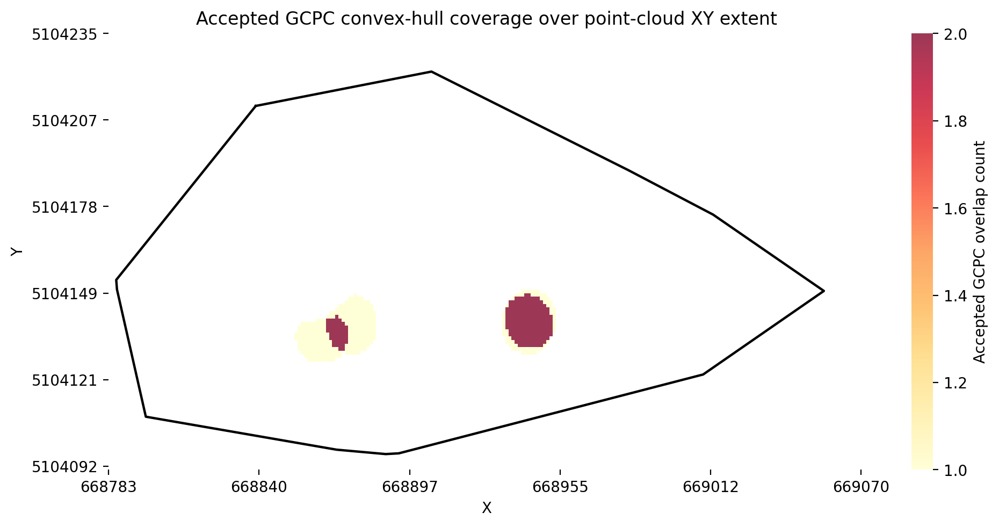

# Point Cloud Georeferencing Accuracy Report

**Date:** 2026-05-26  
**GCPCs accepted:** 4  
**GCPCs rejected:** 0

---

## Final Transformation  (Point cloud -> Global)

| Parameter | Value |
|-----------|-------|
| T_X (m) | 5923.685283890 |
| T_Y (m) | -735.788499182 |
| T_Z (m) | -18622.786656229 |
| 𝜙 (deg) | 0.205675040 |
| 𝜃 (deg) | -0.025744085 |
| 𝜓 (deg) | 0.066396259 |
| Quaternion_xyzw | `0.001794982178  -0.000223619158  0.000579818917  0.999998195920` |

**4 x 4 Transformation Matrix:**

```
    0.999999227609   -0.001160438526   -0.000445155980  5923.685283889953
    0.001158832957    0.999992883698   -0.003590217196  -735.788499182142
    0.000449319039    0.003589698562    0.999993456067  -18622.786656229353
    0.000000000000    0.000000000000    0.000000000000    1.000000000000
```

---

## Per-GCPC Relative Transform Residuals

| GCPC | Fitness | RMSE (m) | dTX (m) | dTY (m) | dTZ (m) | dRX (deg) | dRY (deg) | dRZ (deg) |
|-----:|--------:|---------:|--------:|--------:|--------:|----------:|----------:|----------:|
| 10_TH_1p5_trees | 0.980 | 0.1016 | +0.253061 | +0.090084 | +0.202418 | -0.605718 | +0.342877 | -0.162430 |
| 1_TH_1p5_trees | 0.983 | 0.0507 | -0.049690 | -0.084644 | -0.062929 | -0.231525 | -0.168667 | +0.185845 |
| 3_TH_1p5_trees | 0.982 | 0.0530 | -0.063885 | -0.059821 | -0.060563 | +0.034451 | -0.274665 | +0.401435 |
| 9_TH_1p5_trees | 0.987 | 0.0500 | +0.043841 | +0.113613 | +0.066005 | +0.340886 | +0.324965 | -0.497889 |

---

## Georeferencing Uncertainty

### Error Propagation from GCPC Matching

| Component | Value |
|-----------|-------|
| σ_X (m) | 0.0284 |
| σ_Y (m) | 0.0284 |
| σ_Z (m) | 0.0284 |
| σ_3D(m) | 0.0492 |

### Posterior Consistency From GCPC Single Transformation Result Scatter

| Component | Value |
|-----------|-------|
| σ_X (m) | 0.0502 |
| σ_Y (m) | 0.0518 |
| σ_Z (m) | 0.0479 |
| σ_3D(m) | 0.0866 |
| σ_𝜙 (deg) | 0.1665 |
| σ_𝜃 (deg) | 0.1559 |
| σ_𝜓 (deg) | 0.2158 |
| σ_rot (deg) | 0.3140 |

**Translation covariance matrix from posterior transform scatter (m^2):**

```
    0.00251807    0.00193168    0.00233791
    0.00193168    0.00268782    0.00218179
    0.00233791    0.00218179    0.00229655
```

**Rotation covariance matrix (local tangent frame, deg^2):**

```
    0.02773847    0.00959653   -0.01892009
    0.00959653    0.02431853   -0.03253523
   -0.01892009   -0.03253523    0.04656376
```

---

## GCPC Coverage Heatmap

