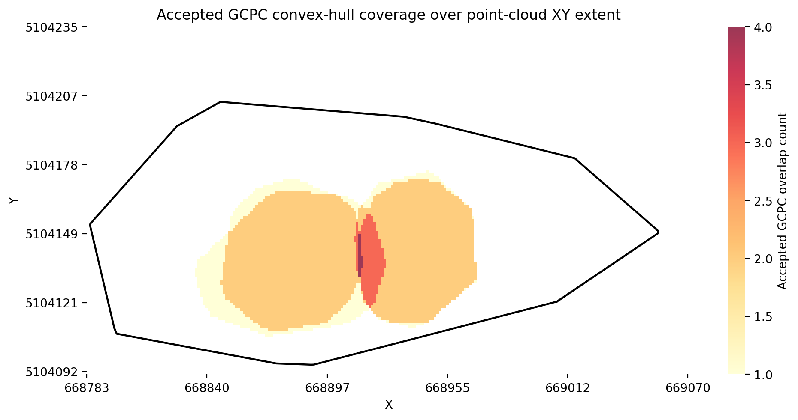

# Point Cloud Georeferencing Accuracy Report

**Date:** 2026-05-26  
**GCPCs accepted:** 4  
**GCPCs rejected:** 0

---

## Final Transformation  (Point cloud -> Global)

| Parameter | Value |
|-----------|-------|
| T_X (m) | 19545.760778718 |
| T_Y (m) | -2523.161374831 |
| T_Z (m) | -1029.534518397 |
| 𝜙 (deg) | -0.014681820 |
| 𝜃 (deg) | -0.200225616 |
| 𝜓 (deg) | 0.219328195 |
| Quaternion_xyzw | `-0.000124778299  -0.001747539246  0.001913771599  0.999996634002` |

**4 x 4 Transformation Matrix:**

```
    0.999986567170   -0.003827094205   -0.003495544322  19545.760778718453
    0.003827966425    0.999992643817    0.000242866976  -2523.161374831001
    0.003494589133   -0.000256244540    0.999993861074  -1029.534518396780
    0.000000000000    0.000000000000    0.000000000000    1.000000000000
```

---

## Per-GCPC Relative Transform Residuals

| GCPC | Fitness | RMSE (m) | dTX (m) | dTY (m) | dTZ (m) | dRX (deg) | dRY (deg) | dRZ (deg) |
|-----:|--------:|---------:|--------:|--------:|--------:|----------:|----------:|----------:|
|    1 | 0.866 | 0.0883 | -0.221540 | -0.004829 | +0.047799 | -0.467200 | -0.430128 | +0.144814 |
|   10 | 0.932 | 0.0800 | +0.202782 | +0.010847 | -0.058741 | +0.133495 | +0.648114 | +0.039866 |
|    3 | 0.850 | 0.0897 | -0.192977 | +0.073180 | +0.035102 | -0.182047 | -0.448152 | -0.346253 |
|    9 | 0.943 | 0.0767 | +0.121740 | -0.059790 | -0.007730 | +0.362476 | +0.056464 | +0.107271 |

---

## Georeferencing Uncertainty

### Error Propagation from GCPC Matching

| Component | Value |
|-----------|-------|
| σ_X (m) | 0.0416 |
| σ_Y (m) | 0.0416 |
| σ_Z (m) | 0.0416 |
| σ_3D(m) | 0.0720 |

### Posterior Consistency From GCPC Single Transformation Result Scatter

| Component | Value |
|-----------|-------|
| σ_X (m) | 0.1070 |
| σ_Y (m) | 0.0273 |
| σ_Z (m) | 0.0239 |
| σ_3D(m) | 0.1130 |
| σ_𝜙 (deg) | 0.1823 |
| σ_𝜃 (deg) | 0.2567 |
| σ_𝜓 (deg) | 0.1067 |
| σ_rot (deg) | 0.3324 |

**Translation covariance matrix from posterior transform scatter (m^2):**

```
    0.01144003   -0.00144720   -0.00243033
   -0.00144720    0.00074589    0.00015480
   -0.00243033    0.00015480    0.00057311
```

**Rotation covariance matrix (local tangent frame, deg^2):**

```
    0.03322168    0.03062097    0.00377354
    0.03062097    0.06589452    0.00931978
    0.00377354    0.00931978    0.01137893
```

---

## GCPC Coverage Heatmap

